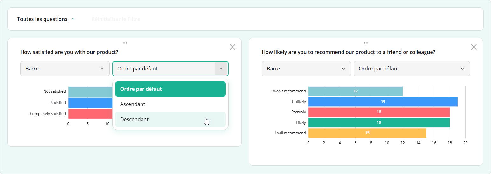
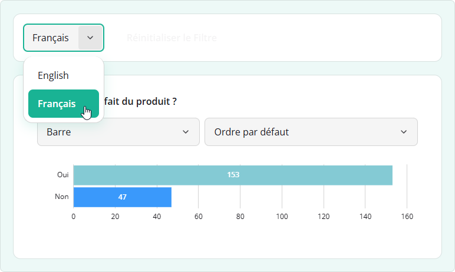

# Localization & Globalization

SurveyJS Dashboard can display the same survey results in different languages. A complete UI translation consists of dashboard controls and survey-derived content&mdash;chart titles and answer labels. This help topic explains how to localize both parts, support language switching, and customize translations for your application.

## Localize Dashboard Controls

### Available Languages

Dashboard UI is translated into more than 10 languages. We ship these translations as [dictionary files](https://github.com/surveyjs/survey-analytics/tree/master/src/analytics-localization) maintained by the community. Some strings are marked `[Auto-translated]`, which means they were translated from English using <a href="https://learn.microsoft.com/en-us/azure/ai-services/translator/" target="_blank">Azure AI Translator by Microsoft</a>. You can [override individual translations](#override-individual-translations) to change their wording.

If your language is not included, use the [English dictionary](https://github.com/surveyjs/survey-analytics/blob/master/src/analytics-localization/english.ts) as a starting point. Copy its keys, provide translated strings, and [register a custom locale](#create-a-custom-locale) in your application.

You can share new dictionaries or improvements to existing translations by submitting a pull request to the [`survey-analytics` repository](https://github.com/surveyjs/survey-analytics). Follow the [dictionary contribution instructions](https://github.com/surveyjs/survey-analytics/blob/master/src/analytics-localization/readme.md) to add your translations to the library.

### Enable Localization and Select a Locale

Dashboard UI dictionaries are included in the `survey-analytics` package and its browser bundles. Importing the package or referencing a Dashboard script loads these dictionaries automatically. See [Get Started](/dashboard/documentation/get-started) for the initial setup.

Dashboard controls use English by default. To apply another language, assign its code to the [`locale`](/dashboard/documentation/api-reference/dashboard#locale) property. For example, `"fr"` applies French:

```js
import { Dashboard } from "survey-analytics";

const dashboard = new Dashboard({
  questions: surveyQuestions,
  data: surveyResults
});

dashboard.locale = "fr";
dashboard.render("dashboardContainer");
```



Setting `dashboard.locale` changes built-in control text, such as "Reset Filter" and chart type names. To translate chart titles and answer labels as well, [localize the survey content](#localize-survey-contents). A multilingual survey can also provide a [language selector](#inherit-the-survey-language) in the dashboard toolbar.

### Override Individual Translations

To change the wording of a built-in caption, get the required dictionary from `localization.locales` and update its corresponding key. For example, the following code changes the French caption of the "Reset Filter" button:

```js
import { localization } from "survey-analytics";

const frenchTranslations = localization.locales.fr;
frenchTranslations.resetFilter = "Effacer les filtres";
```

Apply overrides before rendering Dashboard. Refer to the [English dictionary](https://github.com/surveyjs/survey-analytics/blob/master/src/analytics-localization/english.ts) for the available keys.

### Create a Custom Locale

A custom locale allows you to change several captions together or translate Dashboard controls into a new language. Register it with `setupLocale` from `survey-analytics`. Specify a locale code, an object with translated strings, and an optional `nativeName` for the language selector.

You can keep the dictionary in a separate file. The following example registers a custom English locale with two changed captions:

```js
// custom-locale.js
import { setupLocale } from "survey-analytics";

const customLocaleStrings = {
  resetFilter: "Clear filters",
  chartType_bar: "Bar chart"
};

setupLocale({
  localeCode: "en-custom",
  strings: customLocaleStrings,
  nativeName: "Custom English"
});
```

Import this file before rendering Dashboard, then select the custom locale:

```js
import "./custom-locale.js";

dashboard.locale = "en-custom";
```

Strings omitted from the custom dictionary come from the default Dashboard dictionary, which is English by default. To use another fallback language, set `localization.defaultLocale` before rendering:

```js
import { localization } from "survey-analytics";

localization.defaultLocale = "fr";
```

If a string is also missing in the default dictionary, Dashboard looks for it in the English dictionary.

To add the custom language to the toolbar's language selector, provide survey content translations under the same locale code and [pass the survey model to Dashboard](#inherit-the-survey-language). Registering a UI dictionary alone does not add a language to this selector.

## Localize Survey Contents

Dashboard takes chart titles and answer labels from your survey schema. You can supply these texts in one language or provide several translations so that users can switch languages while viewing the same response data.

### Translate Chart Titles and Answer Labels

Question titles become chart titles, and choice text becomes answer labels. For a survey in one language, assign translated strings to these properties. For a multilingual survey, replace the strings with objects whose keys are locale codes and values are translations.

The following schema contains English and French text. The `default` field supplies text when a translation for the selected language is missing. The survey's `locale` property selects French as the initial language.

```json
{
  "locale": "fr",
  "pages": [
    {
      "name": "feedback",
      "elements": [
        {
          "type": "radiogroup",
          "name": "satisfaction",
          "title": {
            "default": "Are you satisfied with the product?",
            "fr": "Êtes-vous satisfait du produit ?"
          },
          "choices": [
            {
              "value": "yes",
              "text": {
                "default": "Yes",
                "fr": "Oui"
              }
            },
            {
              "value": "no",
              "text": {
                "default": "No",
                "fr": "Non"
              }
            }
          ]
        }
      ]
    }
  ]
}
```

Keep question names and choice values the same in every language. For example, a response remains `{ "satisfaction": "yes" }` whether the chart displays "Yes" or "Oui". Dashboard can then aggregate the same responses while displaying translated labels.

For other survey texts, such as matrix rows and columns, follow the same approach. See the following help topic for more examples:

[Documentation: Localize Survey Contents](/form-library/documentation/survey-localization#localize-survey-contents (linkStyle))

### Inherit the Survey Language

To use the survey's current language for Dashboard controls and chart text, pass its `SurveyModel` instance to the [`survey`](/dashboard/documentation/api-reference/idashboardoptions#survey) option.

The following code uses the schema from the [previous section](#translate-chart-titles-and-answer-labels) as `surveyJson`:

```js
import { Model } from "survey-core";
import { Dashboard } from "survey-analytics";

const survey = new Model(surveyJson);

const dashboard = new Dashboard({
  questions: survey.getAllQuestions(),
  data: surveyResults,
  survey: survey
});

dashboard.render("dashboardContainer");
```

This dashboard starts in French because the schema sets `"locale": "fr"`. Since the schema also contains default English text, the toolbar displays a language selector. Users can switch between English and French, and Dashboard updates the control text, chart titles, and answer labels.



You can also switch languages in code by setting the Dashboard's [`locale`](/dashboard/documentation/api-reference/dashboard#locale) property:

```js
dashboard.locale = "en";
```

[Demo: Localize Dashboard UI](/dashboard/examples/localize-survey-data-dashboard-ui/ (linkStyle))
